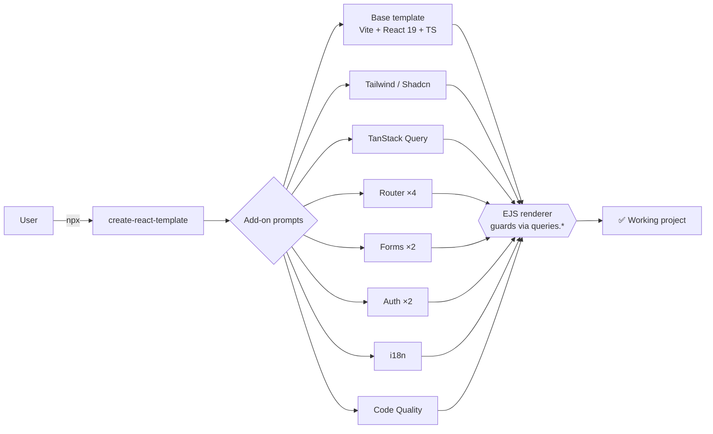

<div align="center">

# ⚡ create-react-template

**The composable React starter — pick your stack, get a working app in seconds.**

[](https://www.npmjs.com/package/@ohk/react-template)
[](LICENSE)

`npx @ohk/react-template` → **Vite + React 19 + TypeScript**, composed with exactly the features you need.

</div>

---

## 🚀 Quickstart

```bash
npx @ohk/react-template
```

Interactive prompts collect:

1. **Project name**
2. **Add-ons** — pick any combination (or none)
3. **Router family** (if Routing selected)
4. **Forms stack** (if Forms selected)
5. **Auth provider** (if Authentication selected)

Non-interactive:

```bash
npx @ohk/react-template my-app
```

---

## ✨ Why this instead of a manual setup?

|                                              | `create-react-template` | `create-vite` + manual setup | Create React App |
| -------------------------------------------- | ----------------------- | ---------------------------- | ---------------- |
| **Router** (4 options)                       | ✅ built-in             | ❌ add + wire yourself       | ❌ not included  |
| **Forms** (RHF+Zod / TanStack)               | ✅ built-in             | ❌ add + wire yourself       | ❌ not included  |
| **Auth** (Clerk / Supabase)                  | ✅ built-in             | ❌ add + wire yourself       | ❌ not included  |
| **Tailwind / Shadcn / Query**                | ✅ built-in             | ✅ one-liner                 | ⚠️ painful       |
| **i18n** (EN/ES demo)                        | ✅ built-in             | ❌ manual                    | ❌ not included  |
| **Git hooks** (Prettier + lint on commit)    | ✅ built-in             | ❌ manual                    | ❌ not included  |
| **Composable combos**                        | ✅ any mix works        | n/a                          | n/a              |
| **EJS composition** (no duplicate templates) | ✅                      | n/a                          | n/a              |
| **Maintained**                               | ✅ active               | ✅ active                    | ❌ deprecated    |

> **tl;dr** — you get a production-shaped app with routing, data, forms, auth, i18n, and git hygiene wired and _working together_, instead of 30 minutes of setup per feature.

---

## 📊 At a glance

_Example timings on a modern Mac, npm cache warm. Your mileage varies._

| Metric                | Value                                                      |
| --------------------- | ---------------------------------------------------------- |
| ⏱️ Scaffold time      | **< 2 s** (base, no deps install)                          |
| 📁 Base template size | **8 source files**, ~4 KB — zero boilerplate pages         |
| 🧩 Add-ons            | **12** combinable overlays                                 |
| 🗂️ Router options     | **4** (SPA + full-stack, React Router & TanStack)          |
| 🧠 Stack              | Vite 8 · React 19 · TypeScript 7 · ESLint 10 (flat config) |

```
create-vite react-ts          → ~8 files, no features
create-react-template (base)  → ~8 files, no boilerplate        (same weight!)
+ tailwind + router + forms   → +~15 files, all wired together  (< 2 s)
```

---

## 🧩 Add-on matrix

| Add-on                           | What you get                                                        | Key deps                           |
| -------------------------------- | ------------------------------------------------------------------- | ---------------------------------- |
| **Tailwind CSS**                 | Utility-first styling, v4 CSS-first                                 | `tailwindcss`                      |
| **Shadcn UI**                    | Copy-paste component library                                        | `shadcn` + Tailwind                |
| **TanStack Query**               | Server-state fetching + caching                                     | `@tanstack/react-query`            |
| **Routing** (pick 1 of 4)        | See below                                                           | —                                  |
| **Forms** (pick 1 of 2)          | See below                                                           | —                                  |
| **Authentication** (pick 1 of 2) | See below                                                           | —                                  |
| **i18n**                         | Multi-language UI, EN/ES demo                                       | `i18next` + `react-i18next`        |
| **Code Quality**                 | Prettier + Lint-Staged + Husky — auto-format & lint on every commit | `prettier`, `lint-staged`, `husky` |

### Routing — choose by need

| Router                   | Type       | SSR | Best for                     |
| ------------------------ | ---------- | --- | ---------------------------- |
| React Router (SPA)       | client     | —   | Simplest, pure client app    |
| React Router (Framework) | full-stack | ✅  | SEO, loaders, server actions |
| TanStack Router          | client     | —   | Type-safe routes, codegen    |
| TanStack Start           | full-stack | ✅  | TanStack family + SSR        |

### Forms / Auth

| Forms                                                     | Auth                                                       |
| --------------------------------------------------------- | ---------------------------------------------------------- |
| **React Hook Form + Zod** — lightweight, schema-validated | **Clerk** — managed email/password + OAuth + SSO           |
| **TanStack Form** — headless, type-safe                   | **Supabase Auth** — OAuth (Google/GitHub), Postgres-linked |

---

## 🧠 Current stack

| Tool        | Version           |
| ----------- | ----------------- |
| Vite        | ^8                |
| React       | ^19.2             |
| TypeScript  | ^7                |
| ESLint      | ^10 (flat config) |
| @types/node | ^26               |

---

## 🏗️ Architecture

**Composition over duplication.** One base template + EJS-driven add-on overlays — no near-identical template bundles.



- **Base template** — Vite + React 19 + TS foundation (`templates/base`)
- **Add-on overlays** — self-contained feature folders (`templates/addons/*`)
- **EJS composition** — `queries.*` booleans gate every conditional import and provider
- **Safe package merge** — deps _and_ scripts merged non-overwrite; your versions always win

---

## 📚 Docs

| Guide                                                        | Purpose                      |
| ------------------------------------------------------------ | ---------------------------- |
| [`docs/adding-addon-guide.md`](docs/adding-addon-guide.md)   | Add a new composable add-on  |
| [`docs/local-testing-guide.md`](docs/local-testing-guide.md) | Test the CLI locally         |
| [`docs/npm-publish-guide.md`](docs/npm-publish-guide.md)     | Version & release flow       |
| [`.github/ARCHITECTURE.md`](.github/ARCHITECTURE.md)         | Structural reference & rules |

---

## 📄 License

MIT — see [LICENSE](LICENSE).
